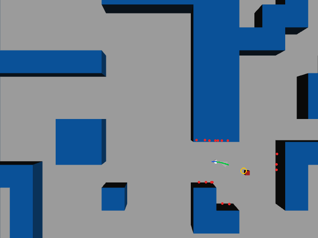
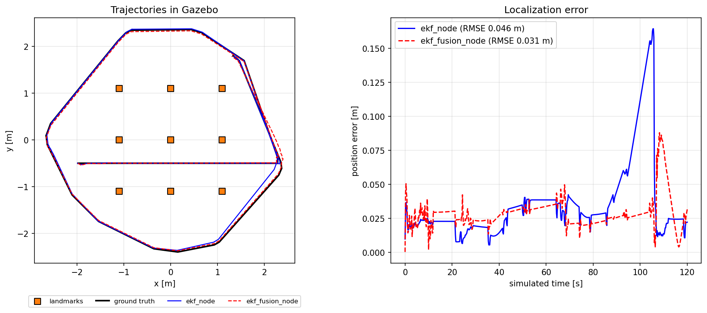
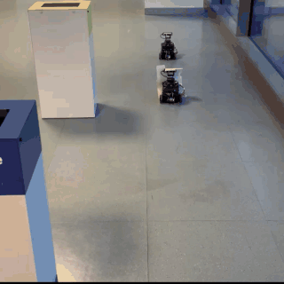
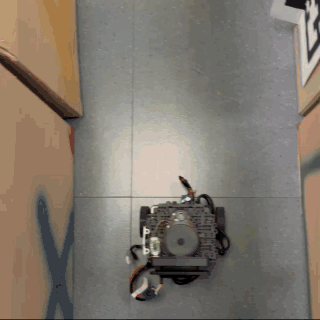
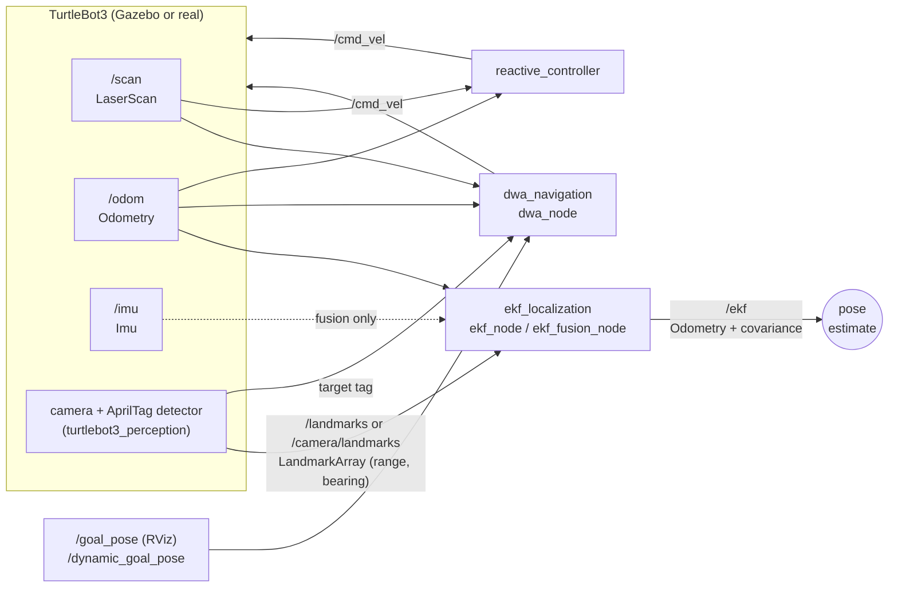

# TurtleBot3 Navigation & Localization with ROS 2

[](https://github.com/ssebba/SESASR/actions/workflows/ci.yml)


[](LICENSE)

Three ROS 2 packages that take a **TurtleBot3** from simple reactive obstacle avoidance
to **probabilistic localization** and **local motion planning**. All the packages were
developed and tuned in **Gazebo** and then run on the **real robot**, using
**AprilTags** as landmarks and as a target to follow.

The project was developed for the course *Sensors, Embedded Systems and Algorithms
for Service Robotics* (SESASR) at Politecnico di Torino.

| DWA chasing a moving goal in Gazebo | EKF vs. ground truth in Gazebo |
| :---: | :---: |
|  |  |

> Left, about 9x real time: the robot (blue trajectory) chases the moving box (yellow
> ring) through `hard_maze`, using the LiDAR obstacles (red) and the rolled-out
> trajectories (green: the chosen one). Right: both EKF nodes on the same run, with the
> robot driven by `reactive_controller`. Both come from real ROS 2 runs and can be
> [reproduced with one command](#record-the-demos).

| DWA on the real robot: chasing a TurtleBot3 that carries an AprilTag | Reactive controller on the real robot |
| :---: | :---: |
|  |  |

> Real robot clips, 5x real time. The EKF was tested on the real robot too, driven by hand.


---

## Packages

| Package | What it does | Key techniques |
| --- | --- | --- |
| [`sesasr_bringup`](sesasr_bringup/) | Starts a Gazebo world and spawns the robot | Launch file shared by the other packages |
| [`reactive_controller`](reactive_controller/) | Drives through a maze without hitting walls | LiDAR sector analysis, reactive control |
| [`ekf_localization`](ekf_localization/) | Estimates the robot pose from landmarks, odometry and IMU | Extended Kalman Filter, velocity motion model, range-bearing sensor model, SymPy Jacobians, sensor fusion |
| [`dwa_navigation`](dwa_navigation/) | Reaches a goal, or follows a moving AprilTag, while avoiding obstacles | Dynamic Window Approach, trajectory roll-out and scoring, LiDAR obstacle extraction |

## Highlights

- **EKF from scratch** with a pluggable motion model: a 3D version (`[x, y, θ]`,
  landmark corrections) and a 5D version (`[x, y, θ, v, ω]`) that also fuses wheel
  odometry and IMU gyroscope readings.
- **Symbolic models**: motion and measurement models are written once in SymPy and
  differentiated automatically. The Jacobians are cross-checked against hand-derived and
  numerical ones in the unit tests.
- **DWA local planner**, vectorised with NumPy (500 trajectories × 40 steps per control
  cycle at 15 Hz). Its cost function supports goal reaching and target following, keeping
  a desired distance from the target.
- **Simulation and real robot from the same code**: every difference (landmark map,
  initial pose, topics) lives in YAML files selected with a launch argument.
- **Measured in Gazebo** over 120 s runs (2 runs of `record_demo.launch.py`):
  position RMSE of 2-5 cm for the EKF. The DWA chased the moving goal through the maze
  with no collisions, with a closest LiDAR reading of about 25 cm.
- **Engineering practices**: ROS-independent core algorithms, unit tests, `flake8` and
  `pep257` linting, GitHub Actions CI on ROS 2 Humble and a Docker image.

## Architecture



## Repository structure

```
.
├── sesasr_bringup/           # Launch file that starts Gazebo and spawns the robot
├── reactive_controller/      # Reactive LiDAR controller (node, launch, params)
├── ekf_localization/
│   ├── ekf_localization/     # EKF core, SymPy models, ROS nodes
│   ├── config/               # ekf_sim.yaml, ekf_real.yaml (landmark maps, noise)
│   ├── scripts/              # Offline demo and model visualisations
│   └── test/                 # Unit tests
├── dwa_navigation/
│   ├── dwa_navigation/       # DWA planner core and ROS node
│   ├── config/               # dwa_sim.yaml, dwa_real.yaml
│   ├── scripts/              # Offline DWA demo
│   └── test/                 # Unit tests
├── dependencies.repos        # External packages (simulation + perception)
├── Dockerfile                # Ready-to-run ROS 2 Humble + Gazebo environment
└── .github/workflows/ci.yml  # Build, lint and tests
```

## Getting started

### Prerequisites

- Ubuntu 22.04 with [ROS 2 Humble](https://docs.ros.org/en/humble/Installation.html)
  (`ros-humble-desktop`)
- Gazebo Classic and the TurtleBot3 packages:
  ```bash
  sudo apt install ros-humble-gazebo-ros-pkgs ros-humble-turtlebot3 python3-vcstool
  ```

### Build

The simulation worlds and the landmark/AprilTag tools come from the course forks of
[`turtlebot3_simulations`](https://github.com/SESASR-Course/turtlebot3_simulations) and
[`turtlebot3_perception`](https://github.com/SESASR-Course/turtlebot3_perception), listed
in [`dependencies.repos`](dependencies.repos).

```bash
mkdir -p ~/sesasr_ws/src && cd ~/sesasr_ws/src
git clone https://github.com/ssebba/SESASR.git
vcs import . < SESASR/dependencies.repos
cd ~/sesasr_ws
rosdep install --from-paths src --ignore-src -y -r
colcon build --symlink-install
source install/setup.bash
export TURTLEBOT3_MODEL=burger
```

> To use the simulator only, without a camera, you can skip the camera drivers with
> `--skip-keys "depthai-ros realsense2_camera perception"` in the `rosdep` command.

### Docker (alternative)

The image contains ROS 2 Humble, Gazebo and all the packages (about 6 GB). This example
runs the EKF comparison without any window, on Linux or Windows, and saves the plot in
the current folder:

```bash
docker build -t sesasr .
docker run --rm -v "$PWD:/out" sesasr \
    ros2 launch ekf_localization record_demo.launch.py output:=/out/ekf_docker.png
```

> Run one simulation at a time. Containers on the same Docker network discover each other
> through DDS, so two simulations would mix their clocks and topics. To run them in
> parallel, give each one its own domain with `-e ROS_DOMAIN_ID=<id>`.

## Usage in simulation

| Task | Command |
| --- | --- |
| Reactive controller in the maze | `ros2 launch reactive_controller reactive_controller.launch.py` |
| EKF with landmarks (3D state) | `ros2 launch ekf_localization ekf.launch.py mode:=sim` |
| EKF with odometry + IMU fusion (5D state) | `ros2 launch ekf_localization ekf.launch.py mode:=sim fusion:=true` |
| DWA navigation in `hard_maze` | `ros2 launch dwa_navigation dwa.launch.py mode:=sim rviz:=true` |

- **EKF:** drive the robot with `ros2 run turtlebot3_teleop teleop_keyboard` and compare
  `/ekf` with `/odom` and with the Gazebo ground truth (`/ground_truth`), e.g. in
  PlotJuggler or RViz.
- **DWA:** the `hard_maze` world contains a moving box that publishes its pose on
  `/dynamic_goal_pose`, and the robot starts chasing it right away. To see what the
  planner is doing, in RViz set the *Fixed Frame* to `odom` and add a *MarkerArray*
  display on `/dwa/markers`.

## Usage on the real robot (AprilTags)

On the real TurtleBot3 the landmarks are **AprilTags** detected by an RGB-D camera
(Intel RealSense or Luxonis OAK-D). The `turtlebot3_perception` package turns each
detection into a `landmark_msgs/LandmarkArray` with the **range and bearing** of the
tag, published on `/camera/landmarks`.

1. **On the robot**, start the base, the camera and the AprilTag detector:
   ```bash
   ros2 launch turtlebot3_bringup robot.launch.py
   export CAMERA_MODEL=realsense            # or: oakd
   ros2 launch turtlebot3_perception camera.launch.py
   ros2 launch turtlebot3_perception apriltag.launch.py
   ```
2. **On the PC** (same `ROS_DOMAIN_ID`), start one of the algorithms:
   ```bash
   # Localization with the tags placed in the arena (map in config/ekf_real.yaml)
   ros2 launch ekf_localization ekf.launch.py mode:=real fusion:=true

   # Follow AprilTag 33, keeping 0.3 m from it, while avoiding obstacles
   ros2 launch dwa_navigation dwa.launch.py mode:=real
   ```

The tag positions measured in the lab arena, the starting pose and the ID of the tag to
follow are parameters in `ekf_localization/config/ekf_real.yaml` and
`dwa_navigation/config/dwa_real.yaml`.

## Offline demos (no ROS)

The core algorithms (`ekf.py`, `models.py`, `dwa.py`) are plain NumPy/SymPy, so they
can be run and tested without ROS:

```bash
pip install numpy sympy matplotlib
python dwa_navigation/scripts/dwa_demo.py                    # animated DWA navigation
python ekf_localization/scripts/ekf_demo.py                  # EKF vs dead reckoning
python ekf_localization/scripts/plot_velocity_motion_model.py
python ekf_localization/scripts/plot_landmark_measurement_model.py
```

## Record the demos

These commands run Gazebo without any window, drive the robot by themselves, save the
result and stop. There is nothing to press:

```bash
ros2 launch dwa_navigation record_demo.launch.py output:=dwa_gazebo.gif
ros2 launch ekf_localization record_demo.launch.py output:=ekf_gazebo.png
```

## Tests

```bash
# Inside the colcon workspace: unit tests + flake8 + pep257
colcon test --packages-select sesasr_bringup reactive_controller ekf_localization dwa_navigation
colcon test-result --verbose

# Or only the algorithm tests, without ROS
cd ekf_localization && python -m pytest test/test_models.py test/test_ekf.py
cd dwa_navigation && python -m pytest test/test_dwa.py
```

## Known limitations

- DWA is a **local** planner: an obstacle lying exactly on the straight line to the goal
  is a local minimum where the robot stops. A global planner (A*, Nav2) would fix this.
- The weights in `dwa_*.yaml` are tuned to chase a close, moving target, which works in
  Gazebo. In the offline simulation the same weights do not start from rest towards a
  far, static goal, so `dwa_demo.py` uses goal-reaching weights instead.
- In `hard_maze` a goal sent from RViz (*2D Goal Pose*) lasts about one second, because
  the moving box publishes a new goal at 1 Hz.
- On shutdown, `ekf_fusion_node` can occasionally print a traceback from inside `rclpy`.
  It only happens while the node is closing and does not affect the estimate.

## Authors

Developed by **Sebastiano Comai** together with **Vito Solito** and **Edoardo Altana**.

## License

[Apache License 2.0](LICENSE)
