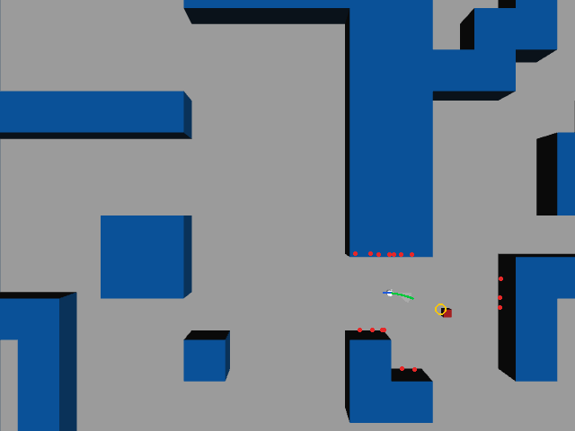
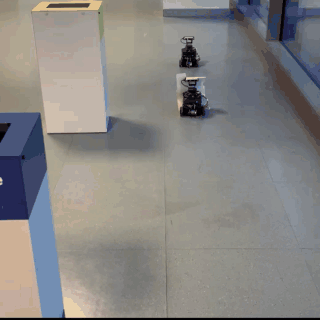
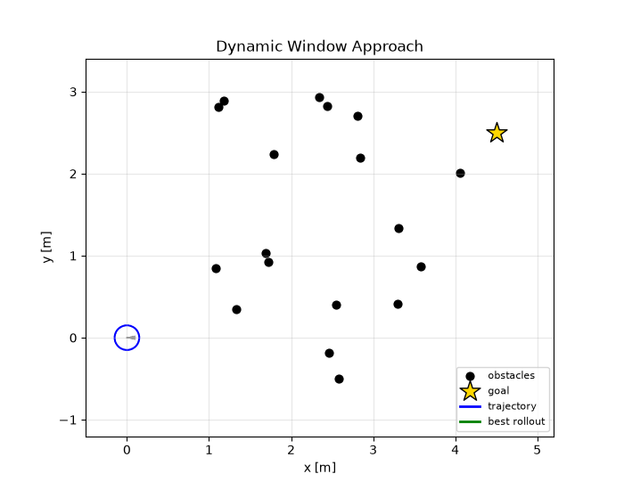

# dwa_navigation

**Dynamic Window Approach** local planner for the TurtleBot3. It reaches a goal while
avoiding the obstacles seen by the LiDAR, or follows a moving **AprilTag**, keeping a
desired distance from it.



*The robot chases the moving box in `hard_maze`, about 9x real time. Reproduce it with
`ros2 launch dwa_navigation record_demo.launch.py`, which needs no window.*

On the real robot, chasing a second TurtleBot3 that carries an AprilTag (5x real time):



## Algorithm

At every control step (15 Hz), [`dwa.py`](dwa_navigation/dwa.py):

1. **Dynamic window**: computes the velocities reachable in one step from the current
   `(v, ω)` given the acceleration limits, clipped to the robot limits.
2. **Roll-out**: samples `v_samples × w_samples` (20 × 25) commands and simulates each one
   at constant velocity. All 500 trajectories are integrated at once with NumPy.
3. **Scoring**: each trajectory gets a weighted sum of min-max normalised terms:

   | Term | Rewards |
   | --- | --- |
   | heading | final heading pointing at the goal |
   | velocity | high speed far from the goal, low speed near it (`velocity_decay`) |
   | obstacles | clearance from the closest obstacle; colliding paths get −100 |
   | target distance | ending at `target_distance_desired` from the target (target following) |

4. Sends the command of the best trajectory to `/cmd_vel`.

Obstacles come from the LiDAR: the scan is split into `num_lidar_ranges` sectors, and the
closest reading of each sector is converted into a point in the odom frame. The node
also has a safety layer: it stops the robot if any reading is below `collision_tol` and
when the `max_steps` timeout expires.

## Goal sources

| Source | Topic | Use |
| --- | --- | --- |
| Moving goal | `goal_topic` (`Odometry`, default `/dynamic_goal_pose`) | published at 1 Hz by the box in `hard_maze` |
| RViz *2D Goal Pose* | `/goal_pose` (`PoseStamped`) | manual goals, in worlds without the moving box |
| AprilTag | `landmarks_topic` (`LandmarkArray`) | follow tag `target_tag_id` on the real robot |

## Run

```bash
ros2 launch dwa_navigation dwa.launch.py mode:=sim rviz:=true   # Gazebo hard_maze + RViz
ros2 launch dwa_navigation dwa.launch.py mode:=real             # real robot, follow AprilTag 33
```

In RViz set the *Fixed Frame* to `odom` and add a *MarkerArray* display on
`/dwa/markers` to see the obstacles (red), a subset of the candidate trajectories (grey)
and the selected one (green).

## Topics

| Topic | Type | Direction |
| --- | --- | --- |
| `/scan`, `/odom` | `LaserScan`, `Odometry` | in |
| `/goal_pose`, `/dynamic_goal_pose`, `/landmarks` | see above | in |
| `/cmd_vel` | `Twist` | out |
| `/dwa_cost/{heading,vel,obs,target,total}` | `Float32` | out: score terms of the chosen trajectory |
| `/dist_to_goal`, `/dwa/min_lidar_range` | `Float32` | out: metrics for plotting |
| `/dwa/markers` | `MarkerArray` | out (if `publish_markers`) |

## Parameters

Set in [`config/dwa_sim.yaml`](config/dwa_sim.yaml) and
[`config/dwa_real.yaml`](config/dwa_real.yaml). The planner weights and the robot limits
are in the `dwa.*` namespace (e.g. `dwa.weight_obs`, `dwa.max_lin_vel`).

## Offline demo

```bash
python scripts/dwa_demo.py                 # animation
python scripts/dwa_demo.py --gif demo.gif  # save it
```



## Tests

`test/test_dwa.py` covers the dynamic window limits, the trajectory roll-out, the
collision penalty, reaching a goal in free space and swerving around obstacles.
