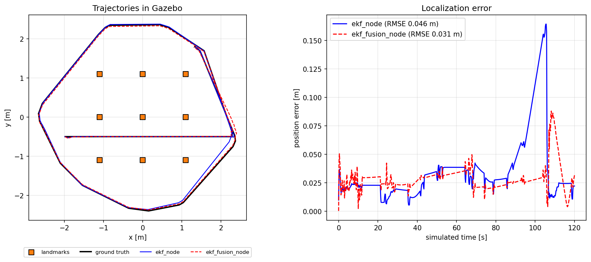
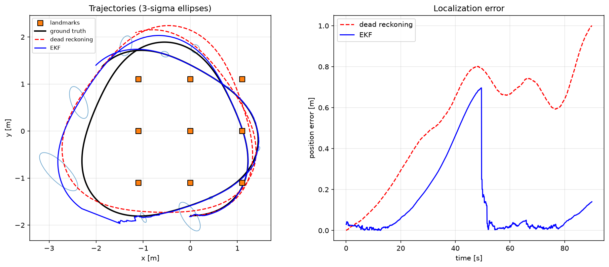

# ekf_localization

Extended Kalman Filter localization of a TurtleBot3 using **known landmarks**: simulated
landmarks in Gazebo, AprilTags on the real robot. The 5D variant also fuses
**wheel odometry** and the **IMU gyroscope**.



*Both nodes on the same 120 s Gazebo run, with the robot driven by `reactive_controller`.
Over two runs the position RMSE was 2-5 cm. Reproduce it with
`ros2 launch ekf_localization record_demo.launch.py`.*

## Nodes

| Node | State | Prediction | Corrections |
| --- | --- | --- | --- |
| `ekf_node` | `[x, y, θ]` | velocity motion model, `u = [v, ω]` from `/odom` | landmarks (range, bearing) |
| `ekf_fusion_node` | `[x, y, θ, v, ω]` | constant-velocity model | landmarks + odometry `[v, ω]` + IMU `ω` |

Both publish the estimate on `/ekf` (`nav_msgs/Odometry`, with the pose covariance of
`x`, `y`, `θ`). The prediction runs at `prediction_rate` (20 Hz).

## Models

**Velocity motion model** (arc of a circle; for `|ω| < 1e-6` it falls back to
straight-line motion to avoid the division by zero):

$$
g(x, u) = \begin{bmatrix}
x - \frac{v}{\omega}\sin\theta + \frac{v}{\omega}\sin(\theta + \omega\Delta t) \\
y + \frac{v}{\omega}\cos\theta - \frac{v}{\omega}\cos(\theta + \omega\Delta t) \\
\theta + \omega\Delta t
\end{bmatrix}
$$

**Control noise**, which grows with the speed:
$M_t = \mathrm{diag}(\alpha_1 v^2 + \alpha_2 \omega^2,\ \alpha_3 v^2 + \alpha_4 \omega^2)$.

**Landmark range-bearing model**. The range is measured in the ground plane, as
published by `turtlebot3_perception` both in simulation and from the AprilTags:

$$
h(x, m) = \begin{bmatrix}
\sqrt{(m_x - x)^2 + (m_y - y)^2} \\
\operatorname{atan2}(m_y - y,\ m_x - x) - \theta
\end{bmatrix}
$$

The models are defined in SymPy ([`models.py`](ekf_localization/models.py)). The
Jacobians `G`, `V` and `H` are derived symbolically and compiled to NumPy at start-up.
The filter ([`ekf.py`](ekf_localization/ekf.py)) uses the Joseph form for the
covariance update and wraps the bearing innovation to `[-π, π)`.

## Run

```bash
ros2 launch ekf_localization ekf.launch.py mode:=sim                 # 3D EKF in Gazebo
ros2 launch ekf_localization ekf.launch.py mode:=sim fusion:=true    # 5D fusion in Gazebo
ros2 launch ekf_localization ekf.launch.py mode:=real fusion:=true   # real robot + AprilTags
```

`mode:=sim` also starts Gazebo (`turtlebot3_world`) and the `landmark_simulator` of
`turtlebot3_perception`. On the real robot the camera and the AprilTag detector must be
running (see the [main README](../README.md#usage-on-the-real-robot-apriltags)).

## Parameters

Set in [`config/ekf_sim.yaml`](config/ekf_sim.yaml) and
[`config/ekf_real.yaml`](config/ekf_real.yaml).

| Name | Description |
| --- | --- |
| `landmarks.id/x/y/z` | landmark map (IDs and positions in the odom frame); `z` is stored but not used by the planar model |
| `initial_pose` | `[x, y, θ]` at start-up |
| `initial_covariance` | diagonal of the initial covariance |
| `motion_noise` | `[α1, α2, α3, α4]` |
| `landmark_noise_std` | `[σ_range (m), σ_bearing (deg)]` |
| `odom_noise_std`, `imu_noise_std` | fusion node only: `[σ_v (m/s), σ_ω (deg/s)]`, `σ_ω (deg/s)` |
| `landmarks_topic`, `odom_topic`, `imu_topic`, `ekf_topic` | topic names |
| `prediction_rate` | prediction frequency [Hz] |

## Offline tools

```bash
python scripts/ekf_demo.py                          # EKF vs dead reckoning, see below
python scripts/plot_velocity_motion_model.py        # samples of the motion model
python scripts/plot_landmark_measurement_model.py   # poses compatible with a measurement
```



## Tests

`test/test_models.py` checks the symbolic Jacobians against analytic and numerical ones.
`test/test_ekf.py` checks that the filter converges from a wrong initial guess, that the
covariance stays symmetric and positive definite, and that it beats dead reckoning on a
simulated trajectory.
