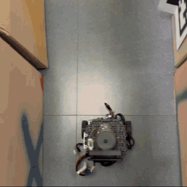

# reactive_controller

A minimal reactive controller that drives a TurtleBot3 through a maze using only the
LiDAR, without a map.



*On the real robot, 5x real time.*

## Behaviour

The 360° scan is split into three sectors:

```
            front: [-0.32, +0.32] rad
                       ▲
     left: [0.1, 2.0] ◄ ● ► right: [-2.0, -0.1]
```

- The robot drives forward at `linear_velocity`.
- When the closest reading in the **front** sector is below `threshold`, it stops and
  rotates in place towards the side with the larger **mean** free distance. That choice
  is frozen while turning, so the robot does not oscillate between left and right.
- It stops when odometry says it is within `goal_tolerance` of `goal`. It also sends a
  stop command when the node is closed with Ctrl-C.

## Run

```bash
ros2 launch reactive_controller reactive_controller.launch.py            # Gazebo maze
ros2 launch reactive_controller reactive_controller.launch.py use_sim:=false  # real robot
```

## Interface

| Topic | Type | Direction |
| --- | --- | --- |
| `/scan` | `sensor_msgs/LaserScan` | in |
| `/odom` | `nav_msgs/Odometry` | in |
| `/cmd_vel` | `geometry_msgs/Twist` | out |
| `/min_distances` | `std_msgs/Float32MultiArray` | out: `[front, right, left]` minimum distances, for plotting |

## Parameters ([`config/reactive_controller.yaml`](config/reactive_controller.yaml))

| Name | Default | Description |
| --- | --- | --- |
| `goal` | `[6.5, 3.0]` | goal position in the odom frame [m] |
| `goal_tolerance` | `1.0` | stop distance from the goal [m] |
| `linear_velocity` | `0.2` | forward speed [m/s] |
| `angular_velocity` | `0.8` | in-place rotation speed [rad/s] |
| `control_frequency` | `5.0` | [Hz] |
| `front_sector_half_angle` | `0.32` | half width of the front sector [rad] |
| `side_sector_min`, `side_sector_max` | `0.1`, `2.0` | angular span of each side sector [rad] |
| `threshold` | `0.35` | frontal distance that triggers a turn [m] |
